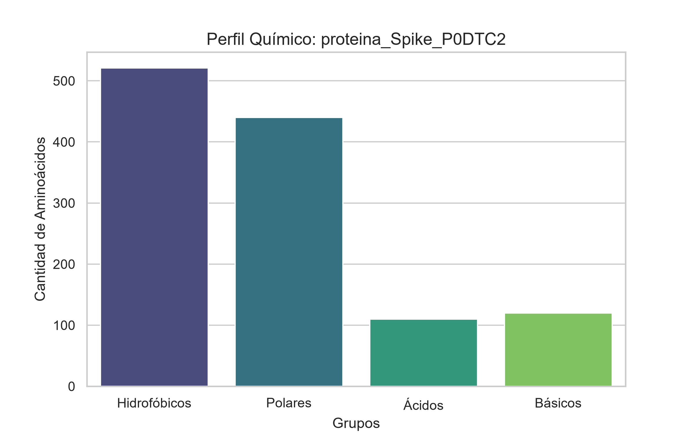

# Carpeta de análisis de muestras

| **Archivo** | **Contenido** |
|---|---|
| Secuencia_Proteína_X | Secuencia de aminoácidos traducida de la secuencia de la muestra |
| Análisis_Proteína_X | Análisis de la composición de aminoácidos de la proteína |
| Gráfico_Proteína_X | Representación gráfica del contenido de aminoácidos de la proteína |
### Perfil Químico de la Proteína Spike (Referencia)

A continuación se muestra la distribución de grupos de aminoácidos para la variante de referencia (P0DTC2):

